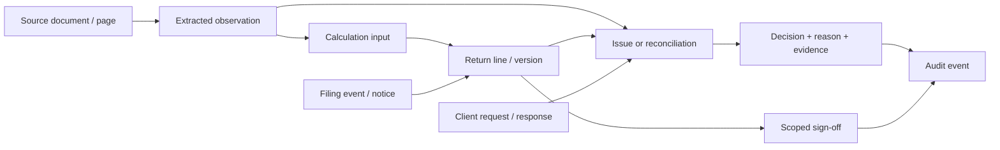

# Evidence graph workpaper

The return is a connected record of claims, sources, calculations, professional decisions, and approvals. The overview puts unresolved, high-risk questions first; a reviewer can follow a return line to its calculation inputs, extracted field, and simulated document page, or follow a document forward to known return lines. Dense details remain searchable so a reviewer can focus on exceptions instead of paging through every transaction.

Every supplied amount is labeled as an engine result. The packet's three computed versions are read-only baselines; a proposed edit becomes a separately stored draft with a reason, evidence references, author, timestamp, and audit event. It does not alter the filed snapshot or imply a recomputed tax. Review notes bind to a scope and version. Blocking notes stop sign-off, and a relevant draft edit marks an existing sign-off stale. The client-question flow stores a response alongside its request and links. Filing history preserves the rejection and acceptance events from the packet.

The app uses a small Python standard-library HTTP API and SQLite database. The original JSON packet stays unchanged and is read directly at runtime. This avoids a database import copy that might drift from the supplied source; application-owned state lives separately in SQLite. Source IDs are stable across both. Document pages are simulated from the packet's `printed_content` because original document files were not supplied. Real files could replace the page renderer without changing the evidence references.

Checks validate packet counts, unique IDs, document links, and return-line evidence references. Cross-record checks expose the corrected Meridian statement's unextracted page 32 lot, while a client answer that conflicts with sales activity remains a completeness question rather than an assumed error. High confidence never means verified. The UI's role selector exercises server-side capability checks, but it is explicitly a local demo header, not authentication. No tax engine, external e-file service, public hosting, or multi-user identity service is included.
